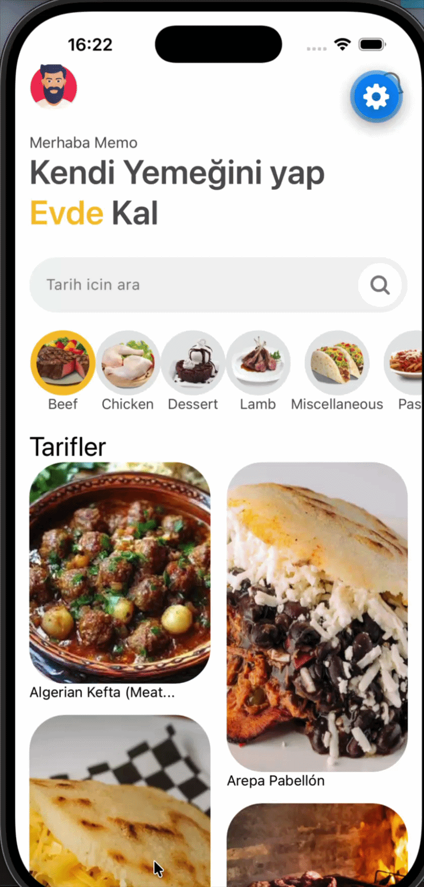

# 🍽️ FoodApp — Kendi Yemeğini Yap, Evde Kal

Kategori bazlı tarif keşfi, arama ve video içerikli yemek tarifleri sunan React Native + Expo mobil uygulaması.

---

## 📸 Ekran Görüntüleri




---

## 🚀 Özellikler

- 👋 Kişiselleştirilmiş karşılama ekranı
- 🔍 Tarif arama
- 🗂️ Kategori filtreleme (Beef, Chicken, Dessert, Lamb, Pasta vb.)
- 🖼️ Masonry grid tarif listesi
- 📺 YouTube video entegrasyonu ile adım adım tarif anlatımı
- ⚙️ Ayarlar ekranı
- 💾 Async Storage ile yerel veri saklama
- 📱 iOS ve Android desteği

---

## 🛠️ Kullanılan Teknolojiler

| Teknoloji | Versiyon |
|-----------|----------|
| React Native | 0.85.3 |
| Expo | ~56.0.4 |
| NativeWind (Tailwind CSS) | ^4.2.4 |
| React Navigation | ^7.x |
| Axios | ^1.16.1 |
| React Native Reanimated | 4.3.1 |
| React Native Gesture Handler | ~2.31.1 |
| YouTube iFrame | ^2.4.1 |
| Masonry List | ^1.4.2 |
| Async Storage | 2.2.0 |

---

## 📁 Proje Yapısı

```
foodapp/
├── assets/
├── src/
│   ├── screens/
│   │   ├── HomeScreen.js
│   │   ├── RecipeDetailScreen.js
│   │   ├── CategoryScreen.js
│   │   └── SettingsScreen.js
│   ├── components/
│   │   ├── RecipeCard.js
│   │   ├── CategoryFilter.js
│   │   └── SearchBar.js
│   ├── navigation/
│   │   └── AppNavigator.js
│   └── api/
│       └── mealdb.js
├── App.js
├── tailwind.config.js
└── package.json
```

---

## ⚙️ Kurulum

### Gereksinimler

- Node.js (v18+)
- Expo CLI
- iOS Simulator veya Android Emulator (ya da fiziksel cihaz)

### 1. Repoyu Klonla

```bash
git clone https://github.com/kullanici-adi/foodapp.git
cd foodapp
```

### 2. Bağımlılıkları Yükle

```bash
npm install
```

### 3. Uygulamayı Başlat

```bash
# Expo Go ile başlat
npm start

# Android
npm run android

# iOS
npm run ios

# Web
npm run web
```

---

## 🌐 Kullanılan API

Bu uygulama **[TheMealDB](https://www.themealdb.com/api.php)** ücretsiz API'sini kullanmaktadır.

| Endpoint | Açıklama |
|----------|----------|
| `/categories.php` | Tüm kategorileri getir |
| `/filter.php?c={kategori}` | Kategoriye göre tarifleri filtrele |
| `/lookup.php?i={id}` | Tarif detaylarını getir |
| `/search.php?s={isim}` | İsme göre tarif ara |

---


## 🤝 Katkıda Bulunma

1. Bu repoyu fork edin
2. Yeni bir branch oluşturun (`git checkout -b feature/yeni-ozellik`)
3. Değişikliklerinizi commit edin (`git commit -m 'Yeni özellik eklendi'`)
4. Branch'i push edin (`git push origin feature/yeni-ozellik`)
5. Pull Request açın

---

## 📄 Lisans

Bu proje MIT lisansı altında lisanslanmıştır.

---

